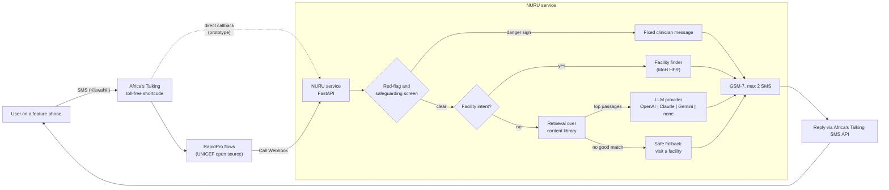

# NURU

**Toll-free, two-way SMS health education for girls, women and parents in Tanzania.**

NURU ("light" in Kiswahili) lets anyone with a basic feature phone and no internet text a health question in Kiswahili to a shortcode and get a short, safe answer in one or two SMS. It covers the life course: adolescence, pre-conception, pregnancy and postpartum, and (phase 2) children under five.

Applicant: **Breezberg Company Limited** (Tanzania), UNICEF Femtech Ventures 2026.

> **Status: prototype.** All health content is `draft_pending_clinical_review`. The facility list is a labelled sample, not the official registry. Do not use for real patients until clinical sign-off and the official MoH data are in place.

---

## The problem

- Many adolescent girls and women in Tanzania rely on feature phones, with no data bundle or smartphone. Most digital health tools assume an app or WhatsApp.
- Questions about periods, contraception, STIs and pregnancy are sensitive. Girls often get answers from peers or myths ("family planning causes infertility", "pregnant women must not eat eggs", "the first milk is dirty").
- Delays in recognising danger signs in pregnancy and in newborns remain a major driver of preventable deaths. People need to know when to go, and where.

## The solution

| Feature | What it does |
|---|---|
| **SMS Q&A** | Text a question in Kiswahili; get an answer of at most 2 SMS, written for a young reader. Free to the user (toll-free shortcode). |
| **Red-flag engine** | Runs **before** any AI. Danger signs (bleeding in pregnancy, convulsions, severe headache with blurred vision, baby not breastfeeding, fever in a newborn and more) trigger a **fixed, clinician-written** "go to a facility now" message. Never AI-generated. |
| **Myth library** | Myth-busting is a core content type: say clearly it is not true, then give the fact. |
| **Facility finder** | Text `KITUO` and your ward or village; NURU replies with the nearest government facility from the Ministry of Health Health Facility Registry (HFR). Location is asked, never tracked. |
| **Grounded AI** | Answers are retrieved from a doctor-reviewed content library, then optionally rephrased by a swappable LLM (OpenAI, Anthropic Claude or Google Gemini). With no API key, NURU sends the library answer directly. |
| **Privacy by design** | Neutral sender, discreet wording, no sensitive history echoed back, phone numbers hashed in logs, safeguarding replies for minors and GBV disclosures. |

NURU **never diagnoses**. When unsure, it advises a visit to a health facility.

## How it works



Order matters and is enforced in code and tests: **red flags, then facility intent, then answer.** See [docs/architecture.md](docs/architecture.md).

## Full-stack plan

| Layer | Prototype (this repo) | Pilot (Dodoma, 2027) |
|---|---|---|
| Channel | Africa's Talking sandbox, two-way SMS | Toll-free (reverse-billed) shortcode across Vodacom, Airtel, Tigo/Yas, Halotel |
| Conversation | Stateless keywords plus a 15-minute pending step | RapidPro flows (opt-in, consent, life-stage enrolment, scheduled tips) |
| Service | FastAPI, `POST /sms/incoming`, `POST /rapidpro/webhook` | Containerised, hosted in-country where possible, Redis session store |
| Safety | Keyword and pattern red-flag rules, fixed messages | Clinician-tuned rules, weekly audit, CHW and nurse call-back escalation |
| Knowledge | 25-entry YAML library, TF-IDF retrieval | Clinically signed-off library of several hundred entries, versioned |
| AI | Swappable LLM, offline fallback | Provider chosen on cost, Kiswahili quality and data-processing terms |
| Facility data | Labelled sample CSV | Official MoH HFR export, refreshed on a schedule |
| Insight | Anonymised in-memory event log | Anonymised MoH insight dashboard (topics, red flags, regions) |

## Quick start

Requires Python 3.10+.

```bash
git clone https://github.com/shaddyt/nuru.git
cd nuru
python -m venv .venv && source .venv/bin/activate
pip install -r requirements.txt
cp .env.example .env            # defaults are offline and safe
```

**Run the CLI simulator** (no SMS, no API key needed):

```bash
python scripts/simulate.py --demo -v        # scripted demo conversation
python scripts/simulate.py                  # interactive chat
python scripts/simulate.py -m "Ni kweli mjamzito asile mayai?"
```

**Run the tests:**

```bash
pytest
```

**Run the service locally:**

```bash
uvicorn nuru.app:app --reload --port 8000
curl http://localhost:8000/health
curl -X POST http://localhost:8000/sms/incoming \
  -d "from=+255700000000" -d "to=12345" -d "text=hedhi ya kawaida ni siku ngapi" \
  -d "date=2026-10-20" -d "id=test1"
```

**Use an LLM** (optional). Set one provider and its key in `.env`:

```bash
NURU_LLM_PROVIDER=anthropic   # or openai, gemini, none
ANTHROPIC_API_KEY=...
NURU_LLM_MODEL=               # optional override
```

If the key is missing or the provider fails, NURU falls back to the library answer.

### Connect the Africa's Talking sandbox

1. Create an account at [africastalking.com](https://africastalking.com) and open the **sandbox** app. Generate a sandbox API key.
2. In `.env` set `AT_USERNAME=sandbox`, `AT_API_KEY=<sandbox key>`, `AT_SHORTCODE=<your sandbox shortcode>`, and `NURU_SMS_DRY_RUN=false`.
3. Expose your local server, for example `ngrok http 8000`.
4. In the sandbox dashboard, under **SMS > SMS Callback URLs > Incoming Messages**, set `https://<your-ngrok-host>/sms/incoming` (add `?token=<NURU_WEBHOOK_TOKEN>` if you set one).
5. Open the sandbox **simulator**, enter a phone number, and send an SMS to your shortcode. The reply appears in the simulator.

### Connect RapidPro (pilot set-up)

In a RapidPro flow, add a **Call Webhook** action (POST) to `https://<host>/rapidpro/webhook`, then a **Send Message** action with `@webhook.reply`. The endpoint returns `reply`, `category` (`red_flag`, `safeguarding`, `facility`, `answer`, `fallback`, `menu`, `stop`) and `rule_id`, so flows can branch, for example to trigger a CHW call-back on `red_flag`.

## Repository layout

```
nuru/
  app.py          FastAPI app: /sms/incoming, /rapidpro/webhook, /health
  router.py       orchestration: red flags -> commands -> facility -> answer
  red_flags.py    Kiswahili + English danger-sign and safeguarding rules, fixed messages
  retrieval.py    TF-IDF over character n-grams, pure Python
  llm.py          provider interface: OpenAI, Anthropic, Gemini, offline
  facility.py     ward / village lookup over the HFR export
  sms.py          Africa's Talking sender (sandbox and dry-run by default)
  formatting.py   GSM-7 transliteration and 2-SMS limit
content/          YAML content library (draft, pending clinical review)
data/             facilities_sample.csv (SAMPLE ONLY)
scripts/          simulate.py CLI chat simulator
tests/            pytest suite
docs/             architecture, safety, content guidelines, roadmap
```

## Roadmap

- **Phase 1, prototype (now):** SMS Q&A, red-flag engine, facility finder, myth library.
- **Phase 2, Dodoma pilot (2027):** life-stage scheduled tips, CHW and nurse call-back escalation, under-five module (danger signs, lishe, immunisation), anonymised MoH insight dashboard.
- **Phase 3, scale:** Kiswahili voice line and USSD, more languages and channels including WhatsApp, other UNICEF programme countries.

**Pilot metrics:** unique users and questions per month; % of answers rated correct by clinician audit; % of red flags correctly escalated; % reporting a facility visit after referral; cost per active user (target under US$1).

Details: [docs/roadmap.md](docs/roadmap.md).

## Safety summary

1. The red-flag and safeguarding screen runs first on every message, including mid-conversation. A match sends a fixed message and stops; the LLM is never called. Tests enforce this.
2. Rules are intentionally broad: an unnecessary "go to a facility" SMS is acceptable, a missed danger sign is not.
3. The LLM only sees the question (phone numbers redacted) and retrieved, clinician-reviewed passages. It is instructed not to diagnose and to refer when the passages do not answer. Any error returns the library answer.
4. Low-confidence retrieval returns a safe fallback that points to a facility, not a guess.
5. Replies never echo the user's message. Logs store a salted hash of the phone number and a category, never message text.
6. GBV and self-harm disclosures get a fixed, supportive message with the free 116 helpline and facility referral.

Full detail: [docs/safety-and-safeguarding.md](docs/safety-and-safeguarding.md) and [docs/content-guidelines.md](docs/content-guidelines.md).

## Licence

[MIT](LICENSE), copyright 2026 Breezberg Company Limited. Content in `content/` is shared under the same licence; reuse it only after your own clinical review.

## Team

- **Dr. Shadrack Omary**: medical doctor and senior full-stack engineer; clinical content lead and technical lead.
- **Dr. George Adriano Nyambuya**: co-founder.
