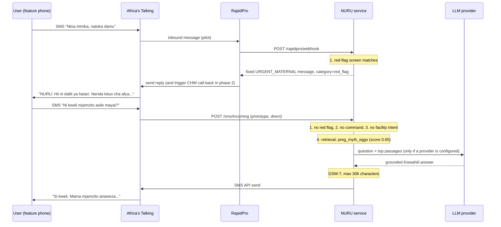

# Architecture

## Message path

In the prototype, Africa's Talking can call NURU directly (`/sms/incoming`) so the demo needs no RapidPro server. In the pilot, RapidPro sits in the middle and owns consent, opt-in, life-stage enrolment and scheduled messages; NURU is the "brain" behind a webhook.

## Components

| Module | Responsibility | Notes |
|---|---|---|
| `nuru/app.py` | HTTP layer | `POST /sms/incoming` takes Africa's Talking form fields `from, to, text, date, id, linkId`. Replies are sent in a background task so the callback returns 200 quickly. `POST /rapidpro/webhook` returns the reply as JSON. Optional `?token=` shared secret. |
| `nuru/router.py` | Orchestration | Fixed order: red flags, commands (`MSAADA`, `STOP`), facility finder, retrieval and answer, fallback. Applies `fit_sms` to every reply. |
| `nuru/red_flags.py` | Safety screen | Ordered rules (regex over normalised text), each mapped to a fixed message. Context-aware rules choose the child, maternal or general message. |
| `nuru/retrieval.py` | Knowledge retrieval | TF-IDF over whole words plus character 3 to 5-grams inside words, cosine similarity. Handles Kiswahili prefixes and suffixes without a stemmer. Pure Python. |
| `nuru/llm.py` | Answer generation | `LLMProvider` interface; OpenAI, Anthropic and Gemini adapters over plain HTTPS; `OfflineProvider` returns the library answer. Errors and empty outputs fall back to the library. |
| `nuru/facility.py` | Facility finder | Loads the HFR export (CSV), government facilities only, matches ward then village, exact then fuzzy. Prefers dispensary and health centre over hospitals for a first visit. |
| `nuru/sms.py` | Outbound SMS | Africa's Talking SDK; `DryRunSender` for tests and the simulator. Logs hashed numbers only. |
| `nuru/formatting.py` | SMS fitting | GSM-7 transliteration, septet counting, cut at the last full sentence within 306 characters. |

## Why these choices

- **Retrieval first, AI second.** The library is the source of truth and is clinically reviewed. The LLM only rephrases within those passages, so swapping providers changes tone and cost, not medical substance. With `NURU_LLM_PROVIDER=none`, NURU still works end to end.
- **Swappable LLM.** Providers differ in Kiswahili quality, price and data-processing terms, and those change. The interface is three lines; adding a provider is one class.
- **No heavy ML dependencies.** TF-IDF in pure Python is enough for a few hundred entries and keeps hosting cheap. If the library grows into the thousands, swap `Retriever` for an embedding index behind the same `search()` method.
- **306, not 320.** Two concatenated GSM-7 SMS carry 2 x 153 = 306 characters (the user data header takes 7 per segment). Any non GSM-7 character (smart quotes, emoji) switches to UCS-2 and roughly halves capacity, so output is transliterated.
- **State is minimal.** The only server-side state is a 15-minute "awaiting location" flag keyed by a salted phone hash. No message text, location or history is stored.

## Configuration

All settings are environment variables, documented in [`.env.example`](../.env.example). Defaults are offline and dry-run.

## Production hardening (before pilot)

- Replace the in-memory `SessionStore` and event list with Redis and an append-only analytics store holding only anonymised fields.
- Load the official MoH HFR export and schedule refreshes.
- Put the service behind HTTPS with the webhook token set; restrict inbound IPs to Africa's Talking and RapidPro where possible.
- Sign a data-processing agreement with the chosen LLM provider, or run `none` mode.
- Add monitoring on red-flag rate, fallback rate and SMS delivery reports.
